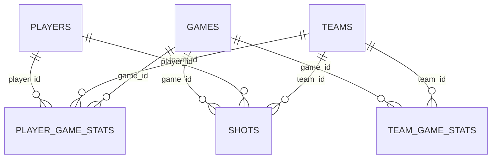

# NBA 数据来源、字段与冻结方案

状态：六张规范化本地数据表及manifest已生成，通过38项校验；尚未公开发布。日期：2026-10-15。

## 1. 选择与可用性

默认使用 SportsDataverse 发布的 **2025–26 赛季中 2025-11-01 至 2025-11-30 的常规赛有限快照**，以 schedule 日期和 `season_type == regular-season` 为共同筛选依据。不是随机采样：保留窗口内全部比赛及对应 player/team/shot 行，支持整月比较、按周统计、逐场滚动、关联和空间分析。首页和图表必须标注窗口，不可称为整赛季或生涯结果。

本次计算得到默认范围：**219 场比赛、30 支球队、498 名名单内球员、5,698 条球员比赛记录（其中 4,784 条分钟字段非空）、438 条球队比赛记录、39,092 次投篮**。名单行不等于实际出场行；分钟字段非空行需在规范化时再次校验时长合法性与正分钟出场。

完整赛季文件保留为核验原料，不直接放 public；跨赛季比较为扩展，当前默认只保证月内趋势。窗口可在用户审查后调整，但必须重新生成所有事实表并更新哈希、覆盖与预设流程。

| 源资产 | 下载后大小 | 原始行/列 | 决策与用途 |
|---|---:|---:|---|
| [player_boxscores_2026.csv](https://github.com/sportsdataverse/sportsdataverse-data/releases/download/nba_stats_player_boxscores/player_boxscores_2026.csv) | 6,131,057 B | 34,786 / 37 | 主球员逐场源；有 6,070 条未出场/备注行，原样保留 |
| [team_boxscores_2026.csv](https://github.com/sportsdataverse/sportsdataverse-data/releases/download/nba_stats_team_boxscores/team_boxscores_2026.csv) | 358,439 B | 2,644 / 29 | 主球队逐场源；不以“球员得分均值”冒充球队得分 |
| [nba_schedule_2026.csv.gz](https://github.com/sportsdataverse/sportsdataverse-data/releases/download/nba_stats_schedules/nba_schedule_2026.csv.gz) | 23,071 B | 1,400 / 15 | 主比赛/日期源；game_id 唯一；常规赛 1,230 场 |
| [shots_2026.csv](https://github.com/sportsdataverse/sportsdataverse-data/releases/download/nba_stats_shots/shots_2026.csv) | 36,414,170 B | 234,876 / 19 | 真实投篮；默认有限窗口，进入投篮分析后加载 |
| [player_season_stats_2026.csv](https://github.com/sportsdataverse/sportsdataverse-data/releases/download/nba_stats_player_season_stats/player_season_stats_2026.csv) | 4,392,214 B | 9,744 / 210 | 可选扩展；不与月内数据混算；需固定 measure/per_mode |
| [player_game_logs_2026.csv](https://github.com/sportsdataverse/sportsdataverse-data/releases/download/nba_stats_player_game_logs/player_game_logs_2026.csv) | 427,596 B | 2,630 / 31 | 排除球员用途；实测为球队行，与源文案不符 |
| [rosters_2026.csv](https://github.com/sportsdataverse/sportsdataverse-data/releases/download/nba_stats_rosters/rosters_2026.csv) | 71,170 B | 495 / 17 | 排除默认来源；异常 season_type 和不全覆盖 |

2025 同类 logs/schedule/season 文件亦已下载核验；作为历史对照，不进入默认包。所有 10 个文件大小与 GitHub API digest 均一致，见 [source-lock](../research/evidence/source-lock.json)。API 显示 shots CSV 更新至 2026-10-09，release 页面正文仍写 10-01；采用资产级时间，不采用较旧正文时间。

## 2. 规范化数据包（Phase 1 已生成）

```text
public/data/nba/2025-26-nov/
  manifest.json
  players.csv                 # 从窗口内 player box 去重得到
  teams.csv                   # 从窗口内 team box 得到
  games.csv                   # 从 schedule 筛窗口得到
  player_game_stats.csv        # 包括 DNP；出场状态明确
  team_game_stats.csv
  shots.csv                   # 延迟加载，有限窗口全部投篮
```

manifest：dataset ID、schemaVersion、范围、非完整赛季声明、source URLs、upstream、asset/release IDs、下载与源更新时间、raw/normalized SHA-256、逐表行数、字段说明、规范化变换、licenseClaim、redistributionStatus、coordinatesVersion、排除/异常计数。字段字典附双语 displayName/description 和单位，不改写用户数据列名。

**players 不含永久所属球队**：球员可转会，球队归属放在 player_game_stats。位置为逐场位置，不自动当作稳定个人属性。姓名从 first_name/family_name 组合；冲突保留 source_name 与警告，不依赖 shots 中可能缩写的 player_name。teams 保存 team_id、team_city、team_name、team_tricode；无球队 logo 或球员照片依赖。

## 3. 字段与源映射

所有 ID 使用 string，保留 `0022500001` 前导零。season 为结束年份 integer，并显示 `2025–26`。日期规范为 ISO 日期字符串，分析时以 UTC 日历处理；展示不把美国比赛日转换成另一天。

| 规范表 | 主键/字段 | 源字段与规范化 | 类型/单位 |
|---|---|---|---|
| players | player_id、player_name | person_id；first_name + family_name | string；string |
| teams | team_id、team_abbr、team_name、team_city | team_id；team_tricode；team_name；team_city | string |
| games | game_id、season、season_type、game_date | schedule 同名字段 | string / integer / category / date |
| games | home_team_id、away_team_id、home_pts、away_pts、home_wl、away_wl | schedule 同名字段 | string / integer / W-L category |
| player_game_stats | game_id、player_id、team_id、side、position、comment | game_id；person_id；team_id；side；position；comment | string / category |
| player_game_stats | game_date、season_type | many-to-one 关联 games | date / category |
| player_game_stats | minutes_raw、minutes、played | minutes `MM:SS`；`MM + SS/60`；有效正分钟出场 | string / number 分钟 / boolean |
| player_game_stats | pts、reb、ast、stl、blk、tov、pf、plus_minus | points；rebounds_total；assists；steals；blocks；turnovers；fouls_personal；plus_minus_points | nullable number，计数原则上 integer |
| player_game_stats | fgm/fga/fg_pct | field_goals_made / attempted / percentage | integer / integer / number 0–1 |
| player_game_stats | fg3m/fg3a/fg3_pct | three_pointers_made / attempted / percentage | 同上 |
| player_game_stats | ftm/fta/ft_pct、oreb、dreb | free_throws_*；rebounds_offensive / defensive | 同上 |
| team_game_stats | game_id + team_id、side | team box 同名 | 复合主键 / category |
| team_game_stats | pts、reb、ast…、fgm/fga… | 同球员指标映射 | 球队每场计数；minutes 是球队总分钟，不是比赛时长 |
| shots | shot_id、game_id、player_id、team_id | raw source hash + 原始行号；game_id；person_id；team_id | string |
| shots | game_date、season_type | join games | date / category |
| shots | period、clock、action_type、sub_type | 源同名 | integer / 原始时钟 string / category |
| shots | shot_result、made、shot_value、shot_distance | Made/Missed；Made→true；源同名 | category / boolean / 2或3 / 英尺 |
| shots | x_legacy、y_legacy、x_ft、y_ft | 原值；候选转换 x/10、y/10，验证前不启用球场 | 原始坐标 / 英尺（待验证） |

可选 player_season_stats：`player_id`；保留 season/season_type/measure_type/per_mode，复合键含这些维度。不能按名字合并；trade/team_count 情况保留原字段，不能把汇总行当各球队行相加。

## 4. 关系和统计口径



- 球员月内场均：默认 `played == true` 后按 player_id 求均值；DNP 不补成一次 0 分出场。记录选择范围和场次数。0 分有效出场不能当缺失。
- 球队胜率：games 主/客侧规范化成 team-game 或连接 team_game_stats，W 数 / 已完成场数；不要从球员行计算胜率。
- 投篮命中率：sum(made) / count(valid result)；没有有效投篮时 null；不得平均每个区域/球员的 fg_pct 充当总体命中率。
- 整体 FG%：sum(fgm)/sum(fga)，分母0为 null。原始 per-game percentage 可分析但不能替代加权总命中率。
- shots 与 player_game_stats 是 many-to-one（game_id + player_id）；反向 join 会扩张行数，预览必须显示扩张系数。不能 join 后重复求和球员 pts。
- “近期变化”只比较观察窗口，注明每组 n 和不等场次数；相关性标注为关联，不下因果结论。

## 5. 坐标启用门槛

本次原始 x 范围 −250…250，y 范围 −51…734，含远距离投篮，**不能默默裁去 y > 半场边界**。Phase 1 要核对上游坐标定义、篮筐原点、单位、方向，与至少若干真实已知区域/距离进行对应；记录排除数和示例。

候选解释是篮筐为原点、单位 0.1 ft。只在证据通过后记录坐标转换版本并启用球场图。半场显示另提供“半场外投篮 n 条”与全范围视图；坐标缺失行保留在统计表中并单列，空间选区只能覆盖有效坐标。

源 shots 没有可靠 event_id：shot_id 用原始资产哈希和行号生成，不用 `game_id+period+clock` 冒充唯一键。不要自动 drop_duplicates：同一时钟、球员、坐标可能是真实不同事件。

## 6. 数据质量门槛

已实测：game_id 唯一；player-game 复合键无重复；所有 box/shot game_id 可在 schedule 找到；所有 shot player-game/team-game 可关联；全部 team-game 的 FGA/FGM 与 shots 汇总一致；常规赛各事实表均覆盖 1,230 场。

Phase 1已完成规范化类型、DNP出场标记、分钟解析、名称冲突检查、维表主外键、team pts与schedule比分对照、PTS=2FGM+FG3M+FTM、投篮FGM/FGA汇总、规范化文件大小和SHA256验证。共12条源时长含`:60`，按秒数进位计算，并保留原始字符串与manifest逐条记录；未发现球员姓名冲突。

规范化CSV共约8.72MB，其中shots约7.74MB、按需加载。shot_id的原始SHA256前缀占用较大，但能稳定追踪每条原始事件，后续可在不丢失身份映射的前提下压缩。

球场坐标核验与官方比赛结果的外部独立抽查仍未完成。内部一致性不代表全部源数据绝对正确。检查记录见 `output/phase1/nba-validation.json`。

## 7. 许可与发布边界

发布仓库标记 [CC BY 4.0](https://github.com/sportsdataverse/sportsdataverse-data)。[NBA 条款](https://www.nba.com/termsofuse)存在上游使用限制；公开再分发资格尚未确认。[NBA FAQ](https://www.nba.com/stats/help/faq)未开放下载。

技术可下载不等于已经证明可公开再分发。manifest 保留 `licenseClaim: CC-BY-4.0` 与 `redistributionStatus: pending-upstream-review` 两个不同字段。有限、冻结、非商业快照与署名是当前方案，不能当作授权结论。Phase 1 可在本地继续引擎和数据质检；Phase 5 在公开打包前核实使用范围。若无法确认，就更换具有清晰再分发权利的真实 NBA 来源/有限表，重新执行源锁与质量门槛；Kaggle 只有候选，不假定获得同等权利。

署名设计：SportsDataverse + 上游 NBA.com/Stats + 下载日期 + 冻结范围 + 来源链接 + 变换说明。原始调研和下载资产只在本地 evidence；本站品牌用自绘几何球场和文字。
