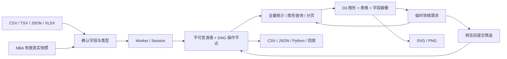

# 交付与验收记录

日期：2026-10-15。当前交付为 **pandas 可视分析工作台 / pandas Visual Analysis Workbench**；NBA 为默认示例。本轮在完成本地审查后，已由用户授权推送与部署；本轮发布状态见文末，原 NBA DataLab 公网记录另标为历史。Phase 0/1 文档作为历史证据保留，界面始终固定浅色。

网站：[GitHub Pages](https://MississippiPotato.github.io/pandas/)；仓库：[MississippiPotato/pandas](https://github.com/MississippiPotato/pandas)。本轮线上版本以文末验证结果为准。

## 交付架构

`core` 不依赖 DOM；统一 Worker 按请求顺序计算，响应带版本，界面查询丢弃晚到结果。源表与结果节点使用稳定字段/行 ID。清洗、筛选、分组、透视、关联、拼接、时间和增强操作共用注册表；图形刷选转为字段范围，不保存像素。预览不修改 Session，提交后进入历史；编辑上游时先验证所有依赖，再原子发布。

取消计算通过终止 Worker 并从最后完成的检查点重建；本机项目仅在用户点击保存后进入 IndexedDB。流程 JSON 只引用源哈希与 schema，项目包明确包含全部当前源数据。Python 脚本只包含活动结果所需的依赖，不携带无关源表。

## 页面与设计

| 页面 | 实际实现 |
|---|---|
| 总览 | pandas 主线与六类任务；工作台/导入为主入口；NBA 数据快照与真实趋势作为默认示例 |
| NBA 探索 | 球员 / 球队 / 时间 / 投篮四个入口；实体与指标选择，D3 范围/空间刷选，当前选区进入工作台 |
| 工作台 | 加载与查看面板 + 五类变换任务；23 个变换与 IQR 筛选；直接可见的方法/含义、参数和限制；自动预览、独立的待应用代码；全宽图形反馈与已应用流程详情 |
| 图库 | 11 个真实当前数据图形入口，字段映射、要求提示，带图形类型回到工作台 |

视觉保留白色/浅灰绿背景、鼠尾草绿层次和青绿交互色。浅色 tokens 与 `color-scheme: light` 固定，不读系统深色偏好。首页表格—聚合图明确标为操作示意，示意中的输入和合计可人工核算；NBA 分析使用真实数据。窄屏图表可横向滚动，避免把辅助标注缩到无法阅读；页面本身不横向溢出。

## 本次本地改造与验收

先核对了路由、真实 Worker 操作、导入、D3 选择、代码生成和历史，而非按按钮判断支持范围。准确的功能审查归类、50 项方法映射与语义差异见 [PANDAS_COVERAGE](PANDAS_COVERAGE.md)。

- 首页与全站品牌改为 pandas 可视分析工作台，NBA 保留为默认示例。六类任务贯穿首页、数据查看区域和变换选择器；旧四条路由保留。
- `operation-catalog.js` 统一任务、方法、含义、关键参数、支持限制与双语文案。方法和一句话含义直接可见，参数及代码可展开。改配置后自动只读预览；手动预览会滚动到结果。导出完整 Python 只包含已应用流程。
- 分组预览显示完整键组合、逐组统计和独立的输入行数图；聚合结果的 `count=1` 明确指当前结果行，输入样本 n 独立保存。后续筛选/排序保留该计数；对聚合结果再聚合会明确提示，不会自动把平均值按 n 加权。
- 缺失处理按字段对比数量/比例，可点击转入配置；适用数值字段的前后直方图共享分箱与纵轴范围。关联显示两表/键/how、源行匹配、输出配对、未匹配、重复键、多对多组和左×右的键关系。滚动图按组比较排序后的原始值与计算值，窗口修改后同步更新。
- 流程显示“任务 · pandas 方法”，点击操作节点打开参数、变化、图形与代码；编辑弹窗也提供真实图形和等价代码。修复相同配置失焦重复预览、分支提交撤销回错表，以及取消另一节点下钻时暗中切换 Worker 活动表的问题。下钻弹窗现在按指定节点只读查询，确认后才提交筛选。恢复项目同时恢复语言、分页大小和保存的图形设置。
- “数据质量”改为按非缺失单元计算的“数据完整率”。通用数据不显示 NBA 命中率；数值/日期字段约束决定可用图形。中英说明性标语已翻译，长字段名与代码可折行，窄屏图表/表格在自身容器滚动。

| 本次检查 | 实际结果 |
|---|---|
| 引擎与历史 | **47/47**；新增每组输入 n 与 count、筛选/排序后的计数、前后分箱、重复/空键匹配、乱序日期分组窗口、预览隔离/恢复及分支撤销回归。 |
| 固定版本独立 pandas | **45/45**；pandas 2.3.3 / NumPy 2.2.6，独立执行导出脚本，逐行逐字段对照。属于这些案例的验证，不是完整兼容证明。 |
| 默认 NBA 数据 | **120/120** 数据断言；本次未改变默认快照。另在 Chrome 检查 4,784 条出场记录、438 条球队记录与 39,092 次投篮。 |
| 非 NBA 连续流程 | **24** 项 Chrome 检查；12 行 commerce → Revenue 填 0 → 去重 11 → Active=true 8 → Region/Month 聚合 6。East/Mar=400、输入 n=2；East/Jan=190。确认前当前表不变；图/表/统计/代码一致。 |
| 关联、滚动与选择 | **19** 项；重复键右表使 12→18 行，匹配输出对数 15，左未匹配 3，右未匹配 1，扩张 1.5。East 6×2=12 匹配对；滚动窗口 2→3 使 3 月 1 日均值 200→145；真实 D3 刷选选中 6 行，应用后范围保持一致。 |
| 现有操作面板回归 | **27** 项；24 个操作入口配置并执行，pivot 重复键明确拒绝；相关矩阵→散点、缺失图→字段清洗、图库→当前数据均通过。预期的 PIVOT_DUPLICATE 在错误反馈和控制台中明确出现。 |
| NBA 联动回归 | **18** 项；实际鼠标刷选、语言切换保留选区、LAL 13 场、区域命中率、空间筛选送入工作台与撤销、390px 及系统深色偏好下固定浅色。 |
| 流程编辑与本机恢复 | **8** 项；预览不变，编辑祖先 Active=false 后 6 组→3 组，撤销回到含 400 的原结果，重做恢复 3 组；IndexedDB 恢复数据/流程。另实际下载并上传哈希绑定流程和含数据项目包，复现三组 0/0/60，项目语言从英语恢复为保存的中文。 |
| 字段约束、双语与窄屏 | **12** 项；3 行长字段名 CSV、一个数值字段禁用散点/相关图、日期+数值启用时间图、NBA 球场约束、完整率命名、中英预览与首屏、390px 无页面溢出、图表局部横向滚动、旧/别名路由。 |
| 实际浏览器导出复现 | 下载的六组 CSV 与 Python 结果逐值相同；另一个下载脚本独立算得 East 窗口 3 为 **100 / 95 / 95 / 145 / 200 / 200**，总 12 行。 |
| 构建 | Vite 生产构建成功；上述浏览器测试使用本地构建产物。本地审查阶段未发布；后续授权部署的独立结果见文末。 |

六组浏览器套件合计 **108 项检查**，另外两项流程/项目文件恢复与下载脚本执行单独记录。不同套件会覆盖同一功能，不能把检查条数当独立 API 数量。

额外的下钻一致性回归：在当前 commerce 源表 12 行时打开其他聚合节点的下钻窗口并取消，实际下载 CSV 仍为 12 行且首个 ID 为 `001`；再确认下钻 East/Feb，结果为 ID=`003` 的 1 行，来自聚合前输入而非混用结果行 ID。证据为 `pandas-drill-cancel.log`、`pandas-drill-cancel.csv` 和 `pandas-drill-apply.log`。导出菜单明确写出“已应用结果 CSV / Applied result CSV”及“已应用流程 Python 脚本 / Applied pipeline Python script”。

可审查入口：`scripts/pandas-refocus.pw.js`、`pandas-feedback.pw.js`、`pandas-history.pw.js`、`pandas-layout.pw.js` 以及复用的 `final-operations.pw.js`、`final-nba.pw.js`。连续验证顺序为：打开本地构建 → 上传 `commerce.csv` 到确认弹窗并运行 refocus → 上传 `region-duplicates.csv` 并运行 feedback → 上传 `regions.csv` 并运行 final-operations → 运行 history。NBA 套件从任意无模态弹窗页面进入示例；layout 从 `long-fields.csv` 导入确认弹窗开始。`history` 使用 refocus 连续链的固定节点 ID，需按此顺序执行。

本地证据：`output/verification/pandas-refocus-browser-summary.json`、`pandas-*-browser.log`、`pandas-all-operations.log`、`pandas-nba-regression.log`、`pandas-refocus-engine.log`、`pandas-refocus-parity.log`、`pandas-parity.json`、`pandas-refocus-data.log`、`pandas-browser-exports.log`、`pandas-flow-restore.log`、`pandas-project-restore.log`。实际截图为 `output/playwright/pandas-*.png` 与本次重跑的 `final-*.png`。这些文件不进入运行资源。

显示限制仍明确保留：分组预览前 30 组、条形图最多 15 组；缺失字段对比前 40 列；逐键关联前 30 项；滚动前 3 组、每组前 200 行。计数、运算、表格全量分页和导出不按这些显示上限截断。浏览器仍执行 JS 白名单，未实现任意 query/Python/UDF、通用 MultiIndex、横向 concat 或时间偏移窗口。

## 既有版本验证（历史）

| 层级 | 实际证据与边界 |
|---|---|
| 引擎 / 历史 | `npm test`：41 个 Node 测试，覆盖严格导入、JSON 大整数/溢出拒绝、null/0/false、稳定排序、空组、透视、关联扩张、UTC、回放、原子编辑、字段身份稳定与安全表达式；属于算法和状态验证 |
| 独立 pandas | `npm run test:pandas`：固定 pandas 2.3.3 / NumPy 2.2.6；生成真正可运行脚本，离线 Python 独立执行，逐字段/逐行比较，数值容差 1e-9。完整 45 个案例已由发布 CI 通过，包含严格转换与混合类型表达式边界 |
| NBA 数据 | `npm run data:validate`：120 项断言，含 81 项官方 PDF 人工录入预期值的独立数值对照；检查 SHA、键、范围、比分与投篮守恒。3 场抽查不是全量错误率估计 |
| 通用业务链 | Chrome：12 行非 NBA CSV → 指定填充 → 去重 11 行 → 布尔筛选 8 行 → 两键/两指标分组 6 行 → 透视 3 行；核对独立合计 400 / 190；实际下载 CSV、SVG、PNG、Python、项目包；撤销/重做/IndexedDB 恢复 |
| 操作面板 | Chrome：24 个面板逐一配置、预览、应用；无聚合 pivot 对重复键明确拒绝。另验证相关矩阵转散点、缺失图进入清洗、图库使用当前表；共 27 项检查 |
| NBA 联动 | Chrome：4,784 条实际出场、438 条球队记录、39,092 次投篮；真实鼠标刷选、选区换语言、球队 LAL 13 场、区域命中率、空间筛选传入 Studio 与撤销，共 18 项检查 |
| Excel / TSV / JSON / 流程 | Chrome：两个非空工作表切换，空白工作表跳过；保留 `001`、数值 0、布尔 false、ISO 日期时间；读取公式缓存值，不执行公式；TSV/JSON 浏览器保留 0/false/ID，q=.75 算得 9；成功的无聚合 pivot、原始行下钻、历史参数编辑、哈希绑定配置恢复通过；实际导出 Python 独立复现 ID=002 / Value=12 |
| 布局与主题 | Chrome 1440px 与 390px；页面无横向溢出；模拟深色系统仍为浅色。截图使用实际浏览器视口，未把设计板截图当网站结果 |

本地证据在 `output/verification/` 与 `output/playwright/`，不进入网站部署。可重复的 CLI 函数脚本为 `scripts/final-commerce.pw.js`、`final-operations.pw.js`、`final-nba.pw.js`、`final-performance.pw.js`；前两者分别从指定导入对话框开始，操作步骤和数据样例保存在仓库中。完整浏览器流程需要运行 Vite 并通过 Playwright CLI 打开 Chrome。

浏览器 Worker + 消息传输合成基准：100,000 行 × 20 列，导入并画像 6,526 ms，筛选并生成快照 1,935 ms，100 组聚合 130 ms；计算期间主线程 20ms 计时器推进 423 次。它验证此设备上的处理与响应能力，不是 NBA 数据或跨设备 SLA；也不是仅引用更快的 Node 纯函数耗时。

## 需要明确的语义与限制

- **不是完整 pandas 实现**：只支持列键关联、纵向 concat、行数滚动窗口、UTC 日历和白名单表达式；不执行任意代码。未支持参数会报错。
- `count` 忽略缺失，`size` 包含全部行；std/var 默认样本 `ddof=1`，分位数线性插值；零、false 与空字符串不混同 null。
- `qcut` 的 Python 导出明确用记录的分位边界调用 `pd.cut`，防止跨运行时浮点差异；没有声称直接调用原生 `pd.qcut` 必定逐边界相同。平列透视也公开辅助函数。
- 点图最多 5,000 个确定性显示样本，保留范围边界与远投；全部统计、空间分格、筛选、导出基于全量。缺失图/类别图的显示截断均在图中说明。
- 原始 NBA 数据是 2025-11 月常规赛快照。保留 DNP、负坐标、原点和 6 次超半场远投；分钟 `:60` 明确进位并保留 `minutes_raw`。
- 球场定义来自供应方文档与代码核验，**未取得 NBA 本站坐标字典**。81 项官方数字通过仅覆盖 3 场，不夸大为全月逐条验证。
- 发布方 README 的 CC BY 4.0 标记、MIT 软件 LICENSE 和 NBA 上游条款分别记录。再分发适用范围继续标记待确认，未声称教学用途自动构成授权。详见 `DATA_VERIFICATION.md`。

## 此前发布验收（不代表本次改造已上线）

发布工作流：引擎测试 → 独立 pandas → 数据核验 → Vite 构建 → 上传 `dist` → GitHub Pages。原始下载、研究全文、环境文件、本机项目与浏览器输出均不部署。

- 运行版本：`c3953695f9b5f10f4603b6e3ad9f05bd50eff242`；后续若仅更新验收文档，不改变运行产物。
- [最终 Actions](https://github.com/MississippiPotato/pandas/actions/runs/38679735885)：build / deploy 均为 success；41 项引擎测试、45 个 pandas 独立对照、120 项数据断言通过。
- 公网首页 HTTP 200；加载 `index-B0M_vuTb.js` 与 `analysis.worker-Oa2Mqrt8.js`，六张实际 CSV 和清单均成功加载。浏览器记录未发现页面脚本异常或站内资源 HTTP 错误。
- Chrome 公网复查 11 项通过：真实总览、生产 Worker、39,092 次投篮延迟加载、真实坐标锁定、SVG 内抽样说明、全量网格、区域选择/进入 Studio、撤销、390px 无溢出、系统深色偏好下固定浅色；其中区域选择得到 389 条真实记录。
- 公网 Excel 的独立解析 chunk 正常加载；两个工作表可读，0 / false / 001 / ISO 日期保留。非法 JSON 大整数明确显示字段 ID / 行 1，并保留已有 2 条结果，未静默改写标识符。
- 公网非 NBA CSV 众数填充通过：12 条记录中缺失 Revenue 实际填为 200，其他字段的缺失仍保留 1 处。
- 实际浏览器导出的 Python 文件另在本机独立执行，精确复现 ID=002 / Value=12 / Active=true。
- 14 个运行文件，约 9.2 MB；`/docs/DELIVERY.md`、`/research/evidence/raw/shots_2026.csv` 与 `/src/main.js` 在 Pages 域均为 404，证明部署包只含运行资源。仓库源码与网站资源分开。
- 六张已提交 CSV 的 Git blob 字节 SHA 与清单逐一相符；原始任务书与深度调研全文的 SHA 与 Phase 0 一致，未改写。
- 默认投篮点图显示 4,898 个确定性样本，6 次超半场投篮全部在显示样本中；完整网格计数为 39,092，y 范围保持 −51…610。

本机最终证据：`output/verification/public-browser.log`、`public-excel.log`、`public-unsafe-json.log`、`github-ci-final.log`、`browser-evidence.json`，以及 `output/playwright/public-*.png`。这些证据不作为静态站点运行依赖。
