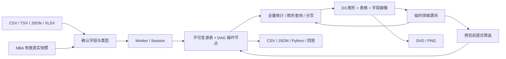

# 交付与验收记录

日期：2026-10-15。当前交付为完整静态网站；Phase 0/1 文档作为历史证据保留。用户的“只用浅色”要求覆盖最初任务书的深色建议。

访问地址：[NBA DataLab](https://MississippiPotato.github.io/pandas/)；仓库：[MississippiPotato/pandas](https://github.com/MississippiPotato/pandas)。部署结果与公网核验记录在本文末尾更新。

## 交付架构

`core` 不依赖 DOM；统一 Worker 按请求顺序计算，响应带版本，界面查询丢弃晚到结果。源表与结果节点使用稳定字段/行 ID。清洗、筛选、分组、透视、关联、拼接、时间和增强操作共用注册表；图形刷选转为字段范围，不保存像素。预览不修改 Session，提交后进入历史；编辑上游时先验证所有依赖，再原子发布。

取消计算通过终止 Worker 并从最后完成的检查点重建；本机项目仅在用户点击保存后进入 IndexedDB。流程 JSON 只引用源哈希与 schema，项目包明确包含全部当前源数据。Python 脚本只包含活动结果所需的依赖，不携带无关源表。

## 页面与设计

| 页面 | 实际实现 |
|---|---|
| 总览 | 真数据统计、每日球队均分趋势、至少出场 5 场的球员场均榜、带条件进入探索 |
| NBA 探索 | 球员 / 球队 / 时间 / 投篮四个入口；实体与指标选择，D3 范围/空间刷选，当前选区进入工作台 |
| 工作台 | 多源管理、字段画像与类型、23 个变换配置器、预览图与变化统计、主图/分布图/分页/代码、流程节点与导出 |
| 图库 | 11 个真实当前数据图形入口，字段映射、要求提示，带图形类型回到工作台 |

视觉采用白色/浅灰绿背景、鼠尾草绿层次和青绿交互色。浅色 tokens 与 `color-scheme: light` 固定，不读系统深色偏好，也不提供主题切换。SVG 球场示意明确标为示意；所有数值卡与分析图使用真实数据。

## 已完成的验证

| 层级 | 实际证据与边界 |
|---|---|
| 引擎 / 历史 | `npm test`：39 个 Node 测试，覆盖严格导入、null/0/false、稳定排序、空组、透视、关联扩张、UTC、回放、原子编辑与安全表达式；属于算法和状态验证 |
| 独立 pandas | `npm run test:pandas`：固定 pandas 2.3.3 / NumPy 2.2.6；生成真正可运行脚本，离线 Python 独立执行，逐字段/逐行比较，数值容差 1e-9。完整 45 个案例已由发布 CI 通过，包含严格转换与混合类型表达式边界 |
| NBA 数据 | `npm run data:validate`：120 项断言，含 81 项官方 PDF 人工录入预期值的独立数值对照；检查 SHA、键、范围、比分与投篮守恒。3 场抽查不是全量错误率估计 |
| 通用业务链 | Chrome：12 行非 NBA CSV → 指定填充 → 去重 11 行 → 布尔筛选 8 行 → 两键/两指标分组 6 行 → 透视 3 行；核对独立合计 400 / 190；实际下载 CSV、SVG、PNG、Python、项目包；撤销/重做/IndexedDB 恢复 |
| 操作面板 | Chrome：24 个面板逐一配置、预览、应用；无聚合 pivot 对重复键明确拒绝。另验证相关矩阵转散点、缺失图进入清洗、图库使用当前表；共 27 项检查 |
| NBA 联动 | Chrome：4,784 条实际出场、438 条球队记录、39,092 次投篮；真实鼠标刷选、选区换语言、球队 LAL 13 场、区域命中率、空间筛选传入 Studio 与撤销，共 18 项检查 |
| Excel / TSV / JSON / 流程 | Chrome：两个非空工作表切换，空白工作表跳过；保留 `001`、数值 0、布尔 false、ISO 日期时间；读取公式缓存值，不执行公式；TSV/JSON 浏览器保留 0/false/ID，q=.75 算得 9；成功的无聚合 pivot、原始行下钻、历史参数编辑、哈希绑定配置恢复通过；实际导出 Python 独立复现 ID=002 / Value=12 |
| 布局与主题 | Chrome 1440px 与 390px；页面无横向溢出；模拟深色系统仍为浅色。截图使用实际浏览器视口，未把设计板截图当网站结果 |

本地证据在 `output/verification/` 与 `output/playwright/`，不进入网站部署。可重复的 CLI 函数脚本为 `scripts/final-commerce.pw.js`、`final-operations.pw.js`、`final-nba.pw.js`、`final-performance.pw.js`；前两者分别从指定导入对话框开始，操作步骤和数据样例保存在仓库中。完整浏览器流程需要运行 Vite 并通过 Playwright CLI 打开 Chrome。

浏览器 Worker + 消息传输合成基准：100,000 行 × 20 列，导入并画像 6,526 ms，筛选并生成快照 1,935 ms，100 组聚合 130 ms；计算期间主线程 20ms 计时器推进 423 次。它验证此设备上的处理与响应能力，不是 NBA 数据或跨设备 SLA；也不是仅引用更快的 Node 纯函数耗时。

## 需要明确的语义与限制

- **不是完整 pandas 实现**：只支持列键关联、纵向 concat、行数滚动窗口、UTC 日历和白名单表达式；不执行任意代码。未支持参数会报错。
- `count` 忽略缺失，`size` 包含全部行；std/var 默认样本 `ddof=1`，分位数线性插值；零、false 与空字符串不混同 null。
- `qcut` 的 Python 导出明确用记录的分位边界调用 `pd.cut`，防止跨运行时浮点差异；没有声称直接调用原生 `pd.qcut` 必定逐边界相同。平列透视也公开辅助函数。
- 点图最多 5,000 个确定性显示样本，保留范围边界与远投；全部统计、空间分格、筛选、导出基于全量。缺失图/类别图的显示截断均在图中说明。
- 原始 NBA 数据是 2025-11 月常规赛快照。保留 DNP、负坐标、原点和 6 次超半场远投；分钟 `:60` 明确进位并保留 `minutes_raw`。
- 球场定义来自供应方文档与代码核验，**未取得 NBA 本站坐标字典**。81 项官方数字通过仅覆盖 3 场，不夸大为全月逐条验证。
- 发布方 README 的 CC BY 4.0 标记、MIT 软件 LICENSE 和 NBA 上游条款分别记录。再分发适用范围继续标记待确认，未声称教学用途自动构成授权。详见 `DATA_VERIFICATION.md`。

## 发布验收

发布工作流：引擎测试 → 独立 pandas → 数据核验 → Vite 构建 → 上传 `dist` → GitHub Pages。原始下载、研究全文、环境文件、本机项目与浏览器输出均不部署。

最终提交、Actions 结果、公网 HTTP 与公网浏览器检查将在完成后写入本节。
