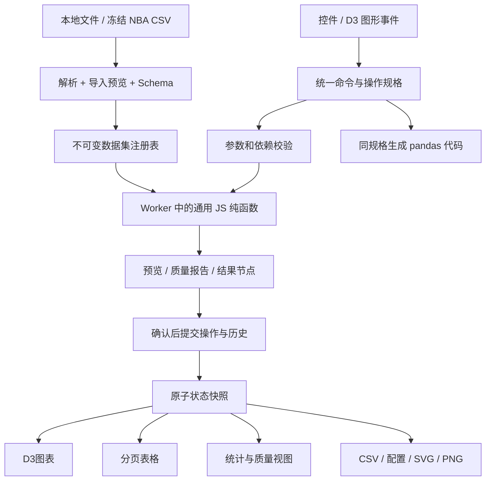

# NBA DataLab · 架构与逐阶段实施计划

版本：Phase 1 / 2026-10-15。用户已审查通过Phase 0；正在实现与验收数据引擎。视觉固定仅浅色，无深色模式或主题切换。当前进度见 PHASE1_REPORT.md；下列阶段计划不等于全部完成。

## 1. 产品交付边界与优先级

固定技术栈：HTML5、CSS3、原生 JavaScript ES Modules、D3、Vite、GitHub Pages。用户 CSV/TSV/JSON 与默认 NBA 数据进入同一套引擎。数据留在浏览器，不要求服务器、API key 或 Python 服务。

| 级别 | 范围 | 发布要求 |
|---|---|---|
| P0：核心必交 | 导入/多表/字段管理、清洗、filter/sort/groupby/agg/pivot、describe/corr、merge/concat、resample/rolling、派生字段、历史、pandas映射、CSV/流程/图表导出、D3联动、双语、四个页面、静态部署 | 所有对应覆盖行必须有引擎结果、真实界面入口和验收证据 |
| P0-D：有数据条件的必交 | NBA真实投篮与空间筛选 | 数据和坐标门槛通过后交付；若未通过，显示具体原因并列为缺项，不能伪造 |
| P1：增强 | Excel、cut/qcut、rank/cumsum/melt、更多高级图表、IndexedDB 会话恢复 | 不阻塞核心，但单独列状态；不能用它们替代未完成P0 |
| P2：暂缓 | 云端协作、登录、实时统计、3D、地理地图、任意Python apply、Parquet | 不纳入本期；避免支撑成本改变技术栈 |

P0 中关联、窗口与时间重采样不留到最后才发现无法运行。P1 只是实现顺序较后，不表示 pandas 所有 API 已覆盖。最终口径是“覆盖明确支持的典型 pandas 能力”，不是“完整复刻 pandas”。

## 2. 模块边界



拟建目录（当前没有这些应用文件）：

```text
src/
  main.js
  core/
    dataset.js             # 字段、行身份、不可变数据节点
    registry.js            # 多数据集、源版本、结果依赖
    store.js               # 单一状态、订阅与原子结果发布
    commands.js            # UI/图形事件到标准命令
    operation-registry.js  # 操作描述符注册
    pipeline.js            # 依赖、执行、下游失效、重放
    history.js             # undo/redo/编辑节点
    pandas-code.js         # 按受支持语义生成代码
    expression.js          # 计算字段白名单 AST
    statistics.js
    operations/            # cleaning/filter/group/pivot/join/time
  data/
    loader.js              # CSV/TSV/JSON；Excel后加
    schema.js              # 类型推断、转换、质量报告
    nba-adapter.js         # 唯一 NBA字段映射边界
  workers/analysis.worker.js
  charts/                  # D3通用图表与统一 lifecycle
  components/              # 表格、配置器、字段、流程、导入
  pages/                   # 四页面用同store与引擎
  i18n/                    # zh-CN/en-US及formatters
  styles/                  # tokens/layout/components/charts
tests/
  fixtures/                # NBA之外的通用小表和golden结果
  engine/                  # 真实语义与边界
  integration/             # 历史、依赖、结果一致性
  browser/                 # 完整上传/操作/导出流程
public/data/nba/2025-26-nov/
.github/workflows/deploy.yml
```

依赖尽量少：D3运行期；Vite构建期；先用 Node 原生 test runner 验证纯函数，需要浏览器自动化时加 Playwright 开发依赖。未来安装时核对官方文档、锁版本及 lockfile；Phase 0 不安装框架或建应用壳。

## 3. 通用数据结构与身份

内部表采用有序字段列表、Map字段索引、按列值数组和独立缺失掩码；行视图采用不可变 rowIndex/rowId。首版允许普通数组，遇到性能实测瓶颈才为数值列加入 TypedArray。schema：

```js
{
  datasetId: 'ds_<uuid>', version: 1, sourceHash: '<sha256>',
  columns: [
    { id: 'col_<uuid>', name: 'Revenue', type: 'number',
      nullable: true, role: 'measure', unit: null }
  ],
  rowIds: ['<sourceHash>:0', '<sourceHash>:1'],
  values: { 'col_<uuid>': [0, null] },
  provenance: { kind: 'local-file', fileName: 'sales.csv', parseOptions: {} }
}
```

fieldId 不随 rename 改变；展示和导出用用户原列名。__proto__、中文、空格和引号等列名只当字符串，不能作为对象原型或执行代码。重复/空列名在导入预览中明确纠正并保留原名映射，不能静默覆盖。

- 原始数据只读。filter/sort共享列数据与行索引；类型/填充/派生只创建变更列。group/pivot/join产生新结果节点与schema。
- rowId 不等于当前行号；sort/filter后保持身份。agg 行身份来自输入版本+规范化分组键；join/concat 行身份含输入节点和左右rowId/输出序号，避免扩张后重复身份。
- lineage 分层：行级操作保留源rowId；聚合保存分组谓词和源节点引用；join记录左右身份。不为每个聚合格长期复制所有成员数组。
- 多表输入引用固定节点版本，不依赖“当前活动表”；删除/替换源显示依赖影响，依赖失效时不能悄悄改用同名数据。

## 4. 导入与类型语义

支持 UTF-8/BOM CSV/TSV：引号、逗号、换行、空值与可选择delimiter；JSON先支持同一数组中的扁平对象及混合字段，缺字段是null。嵌套数组/对象需明确选择展平策略或拒绝，不自动变成 `[object Object]`。编码错误、宽窄行、异常引号给出行/列定位。初版采用 UTF-8；其他编码作为显式重试设置。

两步导入：抽样提出schema → 用户确认 → 全量校验并报告失败。按角色保护 `00123`、超出安全整数的数值字符串和标识符；不凭“全是数字”把 ID/邮编改成数值。用户可以覆盖类型。超出安全整数不做精确数值计算，保留string并提示。

全局 missing 采用内部null：CSV空单元默认为missing，`NA/N/A/null` 等token用户明确选择才转missing；JSON空字符串初始保留为空字符串。0/false/字符串`0`从不靠truthiness判断缺失。NaN/Infinity解析为无效值，先报告；只有用户选择coerce才转null。日期仅识别约定的ISO格式，其他日期需选择format；UTC日历规则，不依赖浏览器 Date.parse 的地域猜测。

## 5. 操作注册表和纯函数契约

```js
// 一个描述符由同一处驱动 UI、执行、校验、说明、代码与测试
{
  type: 'group.aggregate', version: 1,
  paramsSchema: { keys: 'fieldId[]', metrics: 'Metric[]' },
  accepts: 'table', produces: 'table',
  validate(spec, schemas) {},
  execute(inputs, params, context) {},
  predictSchema(schemas, params) {},
  explain(spec, report, locale) {},
  toPandas(spec, bindings) {},
  capabilities: { reversibleByReplay: true, editable: true }
}
```

执行返回 `{tableHandle, schema, qualityReport, lineage, metrics}`；context含abortSignal、requestId、sourceVersion。pure函数不读取DOM或当前页面；查询类返回profile/矩阵而非假装修改原表。

OperationSpec含id/type/version/inputNodeIds/params/enabled/createdAt/semanticsVersion。params存fieldId与明确参数，禁止存可执行JS。复合条件为typed AST：AND/OR/NOT、比较、between、in、isMissing；字符串先支持literal contains/startsWith，不开放任意正则执行。

计算字段白名单：列引用、数值/字符串常量、+−×÷、括号、比较、if、coalesce、abs、round。先实现数值四则、if/coalesce；其他按覆盖项验收。拒绝 eval/Function、属性访问、外部函数和任意apply。除0、溢出、缺失传播产生null和计数报告；pandas代码要显式mask除0，不让Infinity语义漂移。

清洗/去重等预览必须给出 before/after 行列数、缺失、变更单元、无效解析、受影响行和分布变化。未提交的预览不能污染source或已提交pipeline。

## 6. 固定的统计与变换语义

详细功能边界见 [PANDAS_COVERAGE](PANDAS_COVERAGE.md)。核心统一规则：

| 操作 | 固定默认与显式参数 |
|---|---|
| describe | 非空count；mean/median/min/max；std样本ddof=1；分位数线性插值；类别profile单独处理 |
| sum / count / size | sum跳过null，min_count默认0（全空组为0），可显式1；count非空，size全部行；不混淆 |
| groupby | 多键tuple编码；missing组默认保留 dropna=false；输出平表 as_index=false；默认 sort=false、observed=true，代码显式写出 |
| filter | 数值between默认闭区间，bin范围除最后一箱为左闭右开；null数值比较为false；isMissing为显式谓词 |
| sort | 多键稳定排序；升降序逐字段；null默认last；相同键保留输入顺序 |
| dedup | subset与keep=first/last/false；null按同值参与；rowId排除在用户数据重复比较之外 |
| pivot_table | 多行/列键；聚合显式；缺组合null，fillValue用户选；输出扁平列+可逆列元数据；margins后置 |
| pivot | 不聚合；行列键重复报错，用户可改pivot_table，禁止自动相加 |
| merge | inner/left/right/outer、复合键、suffixes、validate；null键匹配null（遵照pandas，不采用SQL默认） |
| concat | axis=0、列并集/交集、缺列null、ignore_index=true；轴1初版不支持，不生成支持它的代码 |
| corr | Pearson；pairwise完整记录；每格显示有效n；minPeriods≥2；常量/样本不足null |
| rolling | 整数行窗口，按组/排序字段稳定排序，trailing/center=false，min_periods默认window；null不计有效样本；组间不串窗口 |
| resample | UTC日历 D / W-MON / MS；closed=left,label=left；输出完整桶，空桶的sum/count/mean按指定聚合规则，周/月起点显式 |

join 在执行前估算重复键乘积和输出行数，超预算先提示；不要限制后静默截断。很多对多默认要求确认扩张预览，但这是产品操作，不是额外发布授权。矩阵/透视超10,000格先选择字段/类别缩小，不能因显示限制改变计算结果。

## 7. 状态、联动与历史

store 区分 sourceRegistry、pipelineGraph、activeNodeId、committedResult、selectionDraft、operationPreview、charts、ui（locale/route）。不在每张图内部维护另一份筛选表。

交互流程：D3像素范围 → scale.invert → 标准领域谓词 → selectionDraft → 引擎计算有效行集合 → 一个同版本viewSnapshot供表格、图表、统计。多个图选区默认AND、同类别多选默认OR；逻辑以chips显示，可清除。选区会更新联动结果，但未写历史；“应用筛选”才生成filter节点，应用后清空临时选区避免二次过滤。

直方图提供灰色提交态背景分布和青绿色当前选择分布，坐标域刷选过程中固定，避免选区越刷越缩。聚合图点击组生成该组对源节点的谓词：可选择筛选当前聚合表或下钻源明细，两者必须有清楚提示；不能把聚合点当成一条原始记录。

undo/redo恢复数据命令快照和对应活动节点，语言/导航不进入数据历史。undo后新提交清空redo分支；编辑早期节点会使其下游重新校验、重算，field依赖不存在则定位失效节点，不发布部分成功结果。多输入pipeline按DAG拓扑顺序执行，检测环。

Worker按requestId/nodeVersion提交结果；迟到结果直接丢弃。执行中的大任务在可中断循环内检查abort，解析/排序不可及时中断时必要时重建Worker并重放源句柄；显示进度和取消。界面只在完整结果成功后原子换版本。错误保留上一个成功结果并明确标注未应用。

## 8. pandas代码与复现

toPandas 与 execute 共用OperationSpec与语义常量。不从UI文本/图表拼接代码。fieldId在每节点schema中解析真实名称，使用可靠Python字符串repr；保留中文、空格、引号和反斜杠。

```python
# 目标语义示例，不是当前网站已运行代码
out = df.groupby(["Region"], as_index=False, dropna=False,
                 sort=False, observed=True).agg(revenue_mean=("Revenue", "mean"))
```

默认不支持的参数明确disabled或报错；代码面板区分“受支持子集的等价代码”“教学近似说明”“尚不能生成”。有差异的操作不展示为等价。代码验证优先覆盖缺失、ddof、join-null、时间桶、pivot列名、rolling min_periods。面板必须包含导入schema与null转换、排序、参数和输出扁平化等必要步骤，不能仅显示会得出不同结果的一行API。

流程导出JSON保存源hash/schema、依赖节点、操作版本/参数、图表配置、locale；默认不嵌用户完整数据。重新加载先重新选择并核对原文件hash，匹配才重放。仅上传同名文件不算复现。有数据携带需求再提供显式bundle选择。

## 9. 性能与静态部署

目标不是无上限“任意数据”；支持任意符合格式/类型/规模要求的表。初始保护值：UTF-8文件50MiB、100,000行、200列、5,000,000单元；超过提示缩小文件，后续按实测调整。解析在Worker分块提前计数，不能先把超大文件完整物化再提示。默认投篮39,092行使用精简列、按需加载。

- Worker持有全量列与结果句柄；主线程只取当前页、聚合及绘图缓冲，避免每次复制完整表。
- 表格默认每页50/100行；性能需要再虚拟滚动。D3小图SVG，大散点D3 scales + Canvas + SVG brush/axis。Canvas不引入第二图表库。
- 超5,000点用Canvas/聚合；若显示抽样，明确标注展示采样n/N；筛选、统计、导出基于全量，绝不用抽样结果计算命中率。
- 缓存键=源版本+规范化spec+selection；小LRU限制内存，不为每步保存全量拷贝；按需重放与检查点。
- 性能验收目标：固定电脑/浏览器版本；10k×20普通表导入≤2s，100k×20筛选p95≤500ms、groupby≤1s，交互结果≤300ms（默认快照），本地默认首个有效视图≤3s，公网≤5s。记录5次warm和cold；这是目标，Phase 0未测。

Vite base按项目仓库路径配置；数据URL由 `import.meta.env.BASE_URL` 构造；四页hash路由避免Pages深链404。Worker用 `new URL(..., import.meta.url)`。Actions `npm ci → tests → build → upload dist → deploy Pages`。锁版、运行期依赖本地打包，避免老师网络下CDN故障。发布只含运行资产，研究原料不进dist。仓库名、URL和可见性留到已有真实仓库时决定，Phase 0不创建远端。

## 10. 阶段任务与退出门槛

| 阶段 | 具体交付 | 验收/测试 | 不通过时 |
|---|---|---|---|
| Phase 0（本次） | 五文档、原始资料清单、10资产源锁、实测审计、设计图 | 原文件hash不变；规划/状态一致；字段与实测对应；覆盖所有任务书必交项 | 修正文档/来源，停在审查 |
| Phase 1A：数据基础 | Vite/ESM最小工程（非Dashboard）、worker协议、Dataset、loader/schema、多表registry、profile、NBA规范化数据 | CSV/TSV/JSON边界及非NBA文件；所有规范化主键/外键；DNP/分钟/日期；源hash；控制台导入demo | 不开始页面视觉冲刺 |
| Phase 1B：核心引擎 | 清洗/字段/表达式、filter/sort、group/agg/pivot、merge/concat、历史与codegen基础 | 每个P0操作有独立golden+空值/空表/错误测试；immutable输入；many-to-many预算；下游编辑/撤销重放 | 修复引擎，阻止假界面 |
| Phase 2：Data Studio | 导入→画像→预览→提交→分组→透视→关联→导出CSV完整路径；分页表；流程编辑；基础D3图；双语自首个控件接入 | 用sales CSV和customer CSV无NBA字段完成流程；表/统计/图一致；undo/redo和语言切换不丢数据；真实下载CSV | 先打通闭环，不开NBA首页 |
| Phase 3：Visual Analytics | missing矩阵、brush、直方图范围、箱线图、相关矩阵、聚合下钻、resample/rolling；SVG/PNG、流程导入导出 | 图形→谓词→结果→历史→代码→重放；null/常量corr；UTC跨月/缺日时间；组内rolling；迟到worker结果 | 任何联动不一致均阻止Phase4 |
| Phase 4：NBA Experience | 高完成度Overview、NBA Explore、球员/球队/时间/投篮；Gallery复用现有图模块；Explore发送Studio | 全部数字来自同引擎；窗口与出场口径可见；坐标门槛；shot区域统计/原始表一致；模板上传任意合格数据可用 | 缺坐标则明确列缺项，不造空间数据 |
| Phase 5：完善/发布 | 四页完成、双语/响应式/键盘/性能、剩余导出、README、Pages；Excel等P1按时间增加 | P0矩阵100% verified；两种语言/桌面/390px实机流程；dist子路径/worker/data正确；Actions成功+公网HTTP+真实浏览器 | 不宣称上线；记录具体缺项 |

每阶段都做构建和适当自动化测试，留输入、期望、实际、浏览器截图/日志、构建commit。Phase 0仅文档/数据核验，无package所以不虚报npm build通过。测试通过不等于公开站点已验证。

工时是工程估计：Phase1 40–55h、Phase2 30–40h、Phase3 30–45h、Phase4 25–35h、Phase5 20–30h，合计145–205h，加约20%调试余量174–246h。没有截止日，不编造开工日/八周完成承诺；按退出门槛推进。

## 11. 必须贯穿的验收案例

通用fixtures至少包含：numeric 0/null/负值、小数；string引号/中文/前导零；boolean false；重复行；重复join键/null键；ISO日期跨月、闰日、乱序和缺日；空表/全空列；恶意列名；不存在字段；大类别pivot。期望结果独立手工计算或开发期固定pandas环境生成并存JSON，不用JS实现自己生成expected。

示例fixture：Region A/A/B/B/null；Revenue 0/10/20/null/40。groupby保留缺失组：A mean=5,size=2,count=2；B mean=20,size=2,count=1；缺失组mean=40；全体count=4,mean=17.5，sample std按ddof=1独立验证。zeros与missing区分。

联动验收需要直接比较rowIds和resultVersion，不只看截图像变化了；代码对照比较schema、整数/string/null和行序，浮点`abs≤1e-9 + rel≤1e-9`；时间桶起点完全一致。图表像素变化不能证明数据操作正确。

发布演示两条主链：
1. 非NBA销售数据：导入→检查类型→缺失填充预览→去重→直方图筛选→按地区聚合→月份透视→客户表关联→撤销重做→中英切换→CSV/流程导出重放。
2. NBA：加载月份快照→出场口径→球员逐场趋势和5场滚动→散点刷选→真实投篮区域→查看FGM/FGA→发送Studio→按球队聚合→图表导出。每步说明范围和分母。

## 12. 预期难点与处置

| 难点 | 失误后果 | 处置与证据 |
|---|---|---|
| 上游名称/字段错位、DNP、混合指标模式 | 漂亮页面展示错误统计 | 已排除错误logs/rosters；适配器/manifest+独立结果抽查 |
| pandas语义差异 | 教学代码与浏览器计算不一致 | 固定缺失/ddof/窗口/时间/join规则；golden结果对照 |
| 多图选区、历史与异步并发 | 图表表格分母不同、旧结果覆盖新结果 | 单store、predicate AST、原子版本、迟到结果测试 |
| 聚合/关联后的行身份 | 选一组却筛掉错误原记录 | 分层lineage、明确下钻节点、复合rowId |
| 大文件/多对多关联/大pivot | 冻结或内存爆炸 | 分块解析Worker、输出预算、预览行数、阻止超量而不截断 |
| 坐标单位与半场远投 | 投篮落在错误位置或被丢弃 | 源定义+已知区域校验，记录transform版本，全范围/半场外计数 |
| 公开数据再分发状态 | 数据可下载但发布范围不清 | 本地证据与生产包分离，发布前核实，不宣称已合法授权 |
| D3自绘和中英长标签 | 可视化交互负担/移动拥挤 | 统一chart lifecycle和tokens，绘制预算，数值输入替代brush，截图验收 |

## 13. 用户审查后下一阶段的具体任务

1. 在当前3目录建立ESM/Vite基础工程、忽略研究raw与本地状态，不制作Dashboard。
2. 实现Dataset/Schema/loader/registry与worker request-version协议；CSV/TSV/JSON完整导入。
3. 根据源锁生成有限NBA CSV与manifest，修正已知源异常；验证分钟、DNP、主外键和坐标。
4. 实现profile和纯函数清洗/筛选/排序/groupby/pivot，再完成merge/concat与安全derive。
5. 实现OperationSpec、历史重放与pandas codegen受支持子集。
6. 用非NBA边界fixtures和固定golden验证；输出Phase1引擎验收报告并展示已实现/待实现矩阵。

审查要点：默认窗口是否采用2025年11月、先引擎后Studio的顺序、仅浅色主视觉、P0完整交付范围、P1增强边界。Phase 0已审查通过；按Phase 1退出门槛实施。

